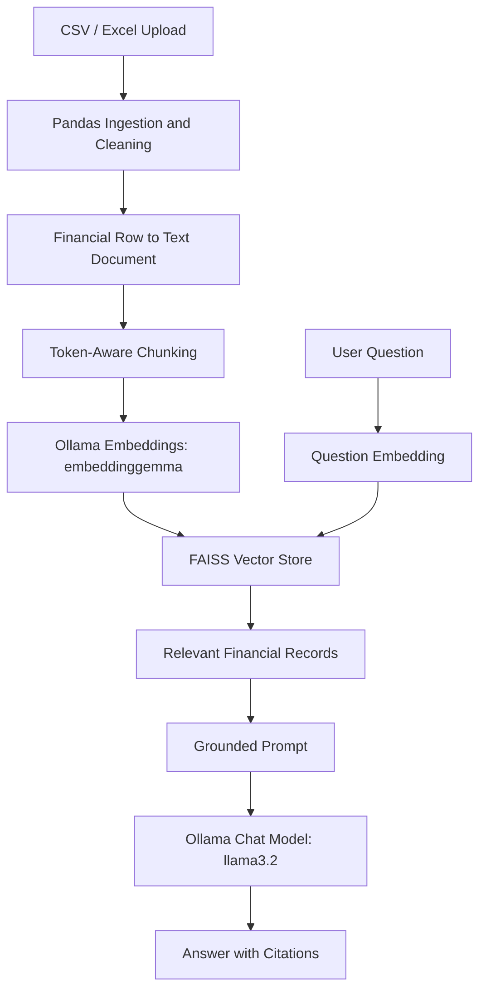

# Financial Statement RAG Assistant

A local Retrieval-Augmented Generation (RAG) application that answers financial-statement questions from uploaded CSV and Excel files using grounded retrieval, FAISS vector search, and Ollama models.

The assistant does not rely on an LLM's internal financial knowledge. It retrieves relevant uploaded records, generates a grounded answer, and displays source-file and row-level citations.

## Features

- Upload CSV, XLS, and XLSX financial statements
- Clean and normalize common financial formats
- Parse currency values such as `$2.15M`, `450K`, and `(300,000)`
- Convert financial rows into retrieval-friendly text
- Generate local embeddings with Ollama `embeddinggemma`
- Store and search vectors with FAISS `IndexFlatL2`
- Answer questions with local Ollama `llama3.2`
- Display row-level citations and retrieval-confidence scores
- Compare Plain LLM and RAG performance with an evaluation framework
- Run entirely locally with no paid API dependency

## Architecture



## Technology Stack

- Python
- Pandas
- LangChain
- Ollama
- FAISS
- Streamlit
- tiktoken
- pytest
- python-dotenv

## Project Structure

```text
financial-rag/
├── app.py                  # Streamlit application
├── ingest.py               # File loading, cleaning, validation
├── document_builder.py     # Financial row-to-text conversion
├── chunking.py             # Token-aware chunking
├── embeddings.py           # Ollama embedding service
├── retriever.py            # FAISS vector store and retrieval
├── rag.py                  # Grounded RAG answer generation
├── citations.py            # Programmatic citations
├── evaluator.py            # Plain LLM vs RAG evaluation
├── run_evaluation.py       # Evaluation runner
├── config.py               # Environment-backed settings
├── utils.py                # Logging helpers
├── tests/                  # Automated tests
├── data/
│   ├── raw/                # Local uploaded files, ignored by Git
│   ├── processed/          # Local generated outputs, ignored by Git
│   └── sample/             # Safe sample data and evaluation cases
└── vectorstore/            # Generated FAISS indexes, ignored by Git
```

## Prerequisites

- Python 3.12+
- [Ollama](https://ollama.com/)

Pull the required local models:

```powershell
ollama pull llama3.2
ollama pull embeddinggemma
```

## Installation

Clone the repository:

```powershell
git clone https://github.com/YOUR_USERNAME/financial-rag.git
cd financial-rag
```

Create and activate a virtual environment:

```powershell
python -m venv .venv
.\.venv\Scripts\Activate.ps1
```

Install dependencies:

```powershell
python -m pip install -r requirements.txt
```

Create your local environment file:

```powershell
Copy-Item .env.example .env
```

## Run the Application

```powershell
python -m streamlit run app.py
```

Then:

1. Upload one or more CSV/XLS/XLSX financial files.
2. Select **Build / Rebuild Index**.
3. Ask a financial question.
4. Review the generated answer, citations, and retrieved financial records.

Example questions:

```text
What was Retail revenue in Q1 2024?
What was net income for the Corporate business unit?
How much cash did Retail report?
What were total assets in Q1 2024?
```

## Supported Data Format

The application works best with long-format financial data:

```csv
Line Item,Value,Quarter,Business Unit
Revenue,2150000,Q1 2024,Retail
Net Income,450000,Q1 2024,Retail
```

Company-specific wide-format files are also supported. For example:

```csv
Company,Year,Revenue,Expenses,Net Profit
Acme,2025,100000,40000,60000
```

The app treats each numeric financial column as a separate metric and keeps
company and year as searchable context. It does not require a fixed template,
but each uploaded table must contain at least one numeric financial measure.

Common column aliases are supported, including:

```text
Line Item / Account / Description → metric
Category → statement_type
Value / Amount / Balance → amount
Quarter / Period → period
Report Date / Date → date
Business Unit / Segment → business_unit
```

## Testing

Run the test suite:

```powershell
python -m pytest -v
```

## Evaluation

The project includes a sample evaluation dataset that compares a Plain LLM with RAG.

Run a quick evaluation:

```powershell
python run_evaluation.py --limit 3
```

Run the complete sample evaluation:

```powershell
python run_evaluation.py
```

Generated evaluation CSV files are stored locally in `data/processed/`.

## Limitations

- Best suited to row-based, long-format financial CSV and Excel data.
- The first Excel sheet is used by default.
- Wide-format spreadsheets and complex multi-sheet reports may require preprocessing.
- Retrieval confidence reflects vector similarity; it is not factual certainty.
- Uploaded data, generated indexes, logs, and local environment files are intentionally excluded from Git.

## Future Improvements

- Wide-table-to-long-table conversion
- Excel sheet selection and header detection
- Persistent user indexes
- PDF financial-report support
- Retrieval reranking
- Larger real-world labeled evaluation datasets
- Docker deployment
